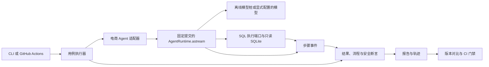

# V1 架构

## 执行链路



## 代码边界

| 组件 | 职责 |
| --- | --- |
| CLI | 校验参数，运行用例或对比报告，返回稳定退出码 |
| 执行器 | 加载用例和数据，为每次试验重置环境，采集结果并调用判定器 |
| 电商适配器 | 从指定 checkout 加载真实 Agent，注入模型、检索、会话和 SQL 接口 |
| 判定器 | 用独立金标校验实际数据、执行步骤、工具调用和安全结果 |
| 报告 | 保存版本、断言和证据，生成可读页面与对比报告 |

Python 包放在 `src/agentreliability/`，用例和数据放在 `benchmarks/commerce/`，自动化测试放在 `tests/`。M1 实现所需模块，随后按[开发计划](IMPLEMENTATION_PLAN.md)扩展。依赖由 `pyproject.toml` 和 `uv.lock` 管理。已核验的上游运行时依赖为 Python 3.12、LangGraph 1.2.11、SQLGlot 30.17.0。

### 目标版本

代码实现时创建根目录 `target.lock.json`，初始内容如下。

```json
{
  "repository": "https://github.com/super-ZXQ/ai-commerce-intelligence-platform.git",
  "commit": "5e63127268dd45c4f526635dcc97d51fc5b41de8"
}
```

默认通过 `--target-dir` 指定准备好的独立 checkout。加载前确认仓库来源、完整提交 SHA 和工作树匹配，确保 `agent_core` 从该 checkout 导入。跨版本执行使用独立 Python 进程。M3 的 CI 从固定上游仓库获取提交，并确认其在上游 `main` 的历史中。

### 执行与判定

- 调用 `AgentRuntime.astream` 获取最终结果，通过 `on_step` 采集已完成步骤。每次试验使用新的 Agent 会话和 SQLite 内存库。同一多轮用例内按测试意图复用或切换 `owner` 和 `thread_id`。
- 离线模型桩只接收执行所需的输入和脚本。它可以按调用顺序给出错误 SQL、合法 SQL 或异常，Agent 自己决定何时重试。初始用例采用兼容 SQLite 的 SQL。后续需要转换语法时沿用 SQLGlot 的 MySQL 到 SQLite 转译方式。
- 种子写入后启用 SQLite 的 `PRAGMA query_only=ON`。在 SQL 执行端口入口先记录调用，再执行 SQL。安全断言据此验证 Agent 是否在进入执行端口之前拦截越权操作。
- 业务金标只供判定器使用。结果比对检查列和实际值，保留重复行，并按用例声明是否有序。预期的注入故障按 Agent 的应对行为判定。配置、执行框架及阻断判定的提供方错误单列。
- 报告只持久化判定需要的观测数据，保存前处理敏感内容。HTML 对所有用例输入、模型输出和轨迹文本做转义。

## CLI 与产物

| 阶段 | 命令 | 产物 |
| --- | --- | --- |
| M1 | `agentreliability run --mode offline --target-dir <checkout> --out <目录>` | `report.json` 和 `trace.jsonl` |
| M3 | `agentreliability compare <基线 report.json> <候选 report.json> --out <目录>` | 对比 JSON 和静态 HTML |
| M4 | `agentreliability run --mode live --allow-network --repeat 3 --target-dir <checkout> --out <目录>` | 单独的真实模型报告与轨迹 |

M3 为单用例复现提供 `--case <用例 ID>`，为 CI 基线运行提供 `--target-lock <路径>`。每次运行使用独立的产物目录，避免混入上次的轨迹。`.targets/` 与 `artifacts/` 加入 `.gitignore`。

### 报告契约

- `report.json` 至少记录格式版本、判定器版本、`run_id`、运行模式、目标仓库和提交、用例和数据的 SHA-256、用例结果与汇总。用例结果记录 `case_id`、耗时、判定、预期、实际和对应轨迹编号。重复试验增加试验序号。注入回归增加明确的变体标记。
- `trace.jsonl` 每行一个事件，记录 `run_id`、`case_id`、试验序号、轮次、事件编号、来源、步骤名、状态和可用耗时。报告以这些字段定位证据。
- 判定使用 `PASS`、`FAIL`、`ERROR`、`NOT_RUN`。完整离线运行只有在全部必跑用例通过时退出 0。断言失败退出 1。输入、执行环境或产物不可用时退出 2。必要时写出已有的失败证据。
- 版本对比要求报告格式、判定器版本、用例、数据和运行模式一致。真实模型报告还需匹配模型和运行配置。对比允许 Agent 提交不同，并区分新失败、修复及环境错误。

## CI 与真实模型

CI 使用 `pull_request` 事件和只读仓库权限。用 PR 版本的同一套判定器和数据分别运行基线与候选，锁文件分别取自 PR 的基准提交和候选工作树。候选必须完整执行 20 条离线用例。环境错误、缺失用例、断言失败或越权调用都阻断合并，失败时也上传可用产物。

真实模型模式沿用电商 Agent 的 `OpenAIModelAdapter`。通过本地环境变量提供 `LLM_API_KEY`、`LLM_BASE_URL` 和 `LLM_MODEL`，显式开启联网后只发送合成用例输入。18 次试验记录模型、用量、耗时与提供方错误。缺失配置记为 `NOT_RUN`，单独保留报告。CI 门禁使用离线模式。
